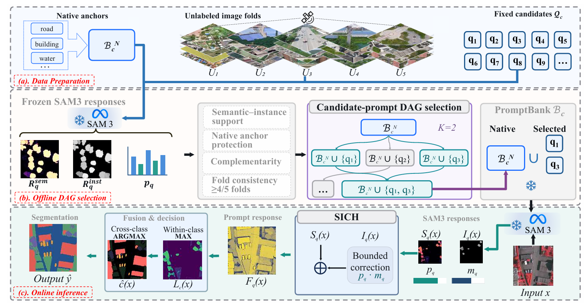
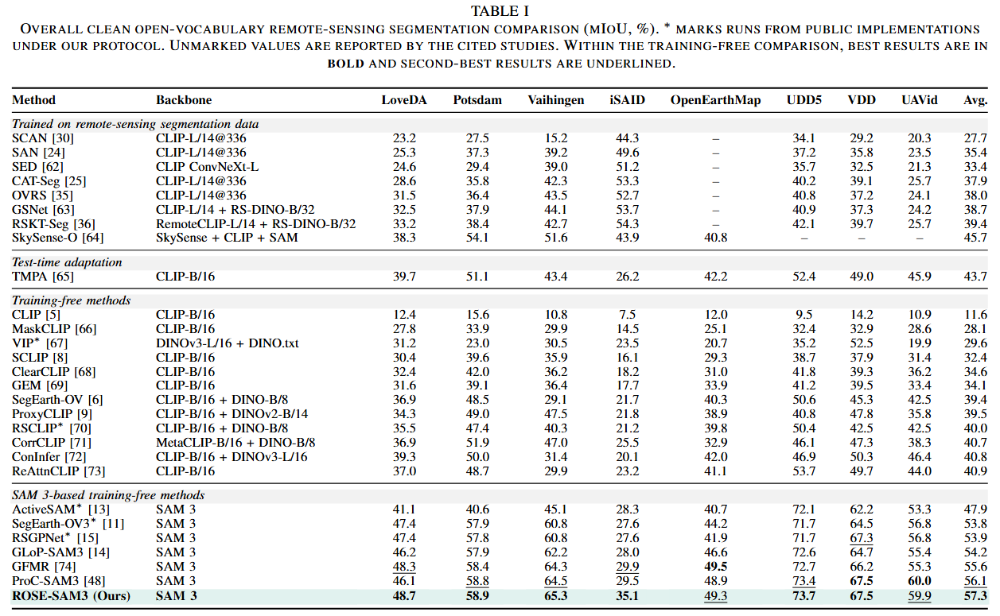
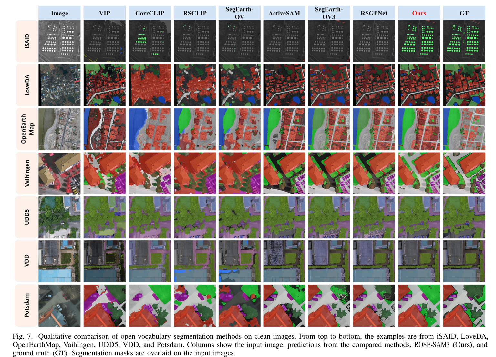
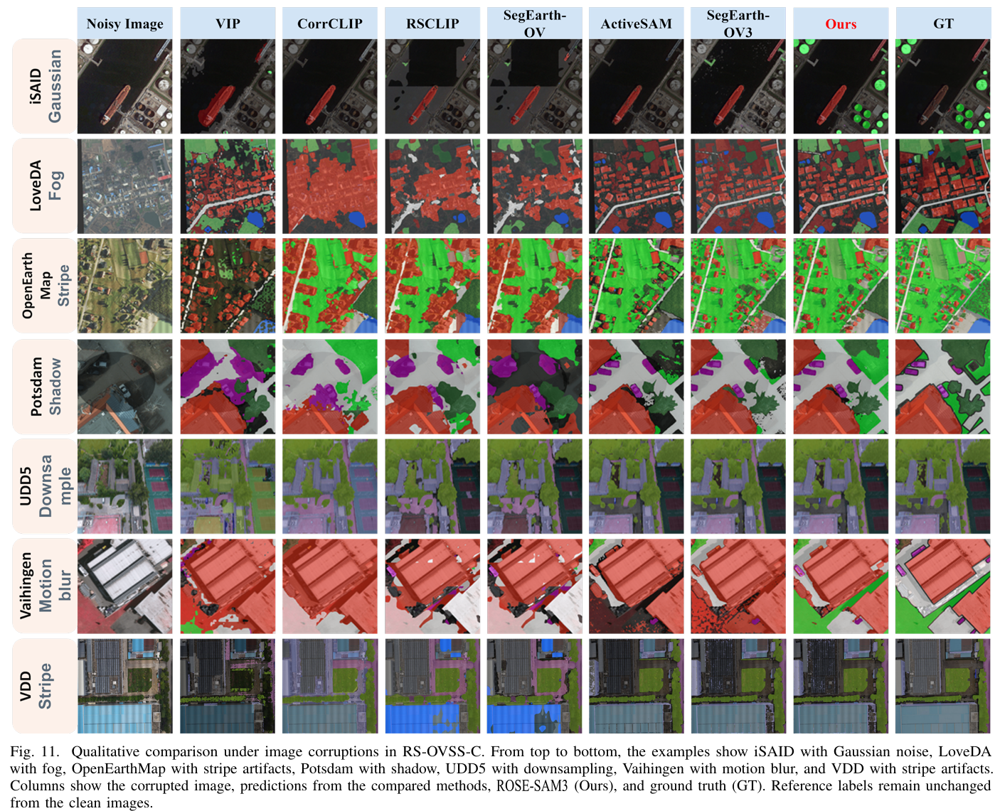

# ROSE-SAM3

Response-guided PromptBank compilation and semantic–instance cooperation for frozen SAM 3 remote-sensing segmentation.

## Overview and results









The released iSAID PromptBank contains 25 queries; its mIoU has not been re-evaluated against the paper's 26-query configuration.

## Installation

Use Linux with an NVIDIA GPU. The environment uses Python 3.10, PyTorch 2.4.0 and CUDA 12.1.

```bash
git clone https://github.com/YanghuiSong/ROSE-SAM3.git
cd ROSE-SAM3
conda env create -f environment.yml
conda activate rose-sam3

export PIP_CONSTRAINT="$PWD/requirements.txt"
python -m pip install torch==2.4.0 torchvision==0.19.0 \
  --index-url https://download.pytorch.org/whl/cu121
python -m pip install -r requirements.txt
python -m pip install openmim
mim install 'mmengine==0.10.7'
mim install 'mmcv>=2.0.0,<2.2.0'
python -m pip install mmsegmentation==1.2.2

git clone https://github.com/facebookresearch/sam3.git "$HOME/src/sam3"
git -C "$HOME/src/sam3" checkout a13e358df479a80938c8bfed0e0754bea8fdb277
python -m pip install --no-deps -e "$HOME/src/sam3"
```

Download the checkpoint and BPE vocabulary from [SAM 3](https://github.com/facebookresearch/sam3), then set their paths:

```bash
export SAM3_ROOT="$HOME/src/sam3"
export SAM3_CHECKPOINT=/absolute/path/to/sam3.pt
export SAM3_BPE_PATH=/absolute/path/to/bpe_simple_vocab_16e6.txt.gz
export PYTHONPATH="$SAM3_ROOT:${PYTHONPATH:-}"
```

MMCV must match the installed PyTorch/CUDA combination; see the [MMCV installation guide](https://mmcv.readthedocs.io/en/latest/get_started/installation.html).

## Segmentation inference

The frozen PromptBanks and dataset settings are included.

```bash
# Evaluate all eight datasets.
bash scripts/run_main_table.sh

# Or evaluate selected datasets.
bash scripts/run_main_table.sh openearthmap udd5 vaihingen
```

Results are saved to `work_dirs/main_table/<dataset>/`.

## Acknowledgments

We thank [SAM 3](https://github.com/facebookresearch/sam3), [SegEarth-OV3](https://github.com/earth-insights/SegEarth-OV-3), [RSGPNet](https://github.com/wangshanwen001/RSGPNet), and the dataset providers.

Original code is available under the [MIT License](LICENSE).
